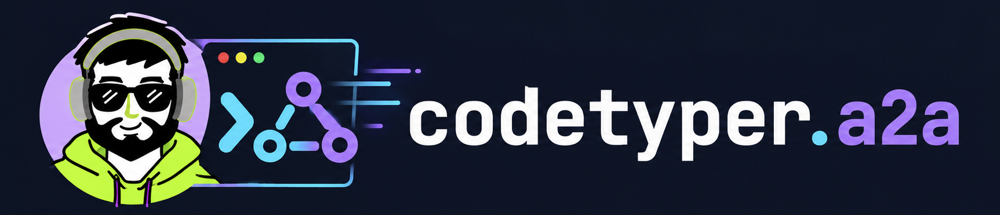
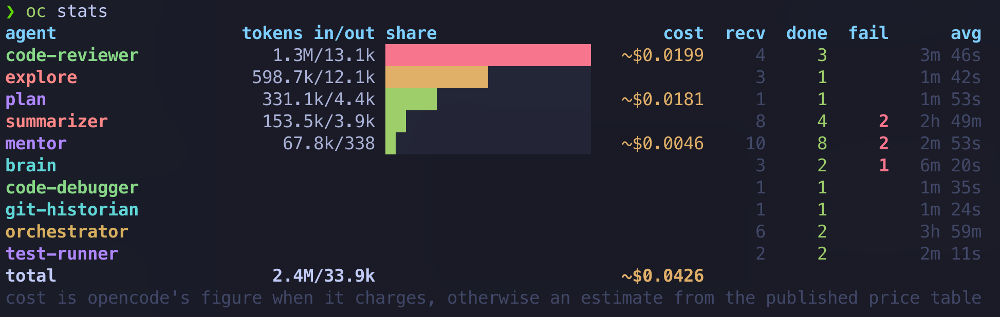
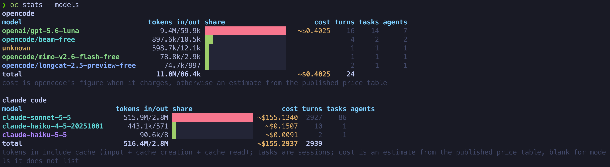
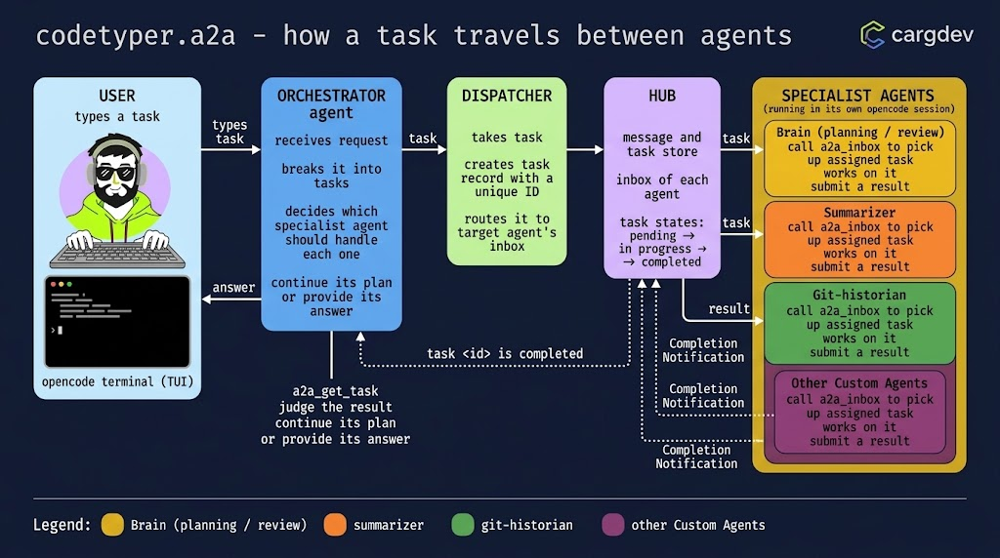
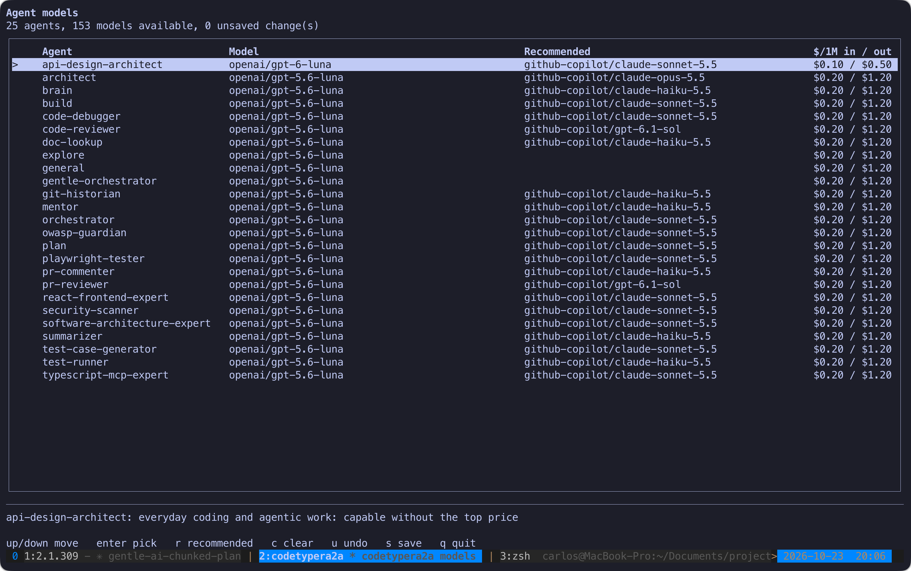

<!-- markdownlint-disable-next-line MD041 -->
<a id="top"></a>

<div align="center">




<h1>codetyper.a2a</h1>

<p><strong>An agent-to-agent hub for opencode v2: every agent in its own tab, one orchestrator in charge.</strong></p>

<p>
<a href="https://github.com/CarGDev/codetyper.a2a/releases"></a>


<a href="LICENSE"></a>
</p>

<p>
<a href="#use"><strong>Use</strong></a> &bull;
<a href="#install"><strong>Install</strong></a> &bull;
<a href="a2a/PROTOCOL.md"><strong>Protocol</strong></a> &bull;
<a href="CHANGELOG.md"><strong>Changelog</strong></a> &bull;
<a href="https://cargdev.io/"><strong>Website</strong></a> &bull;
<a href="https://cargdev.io/blog"><strong>Blog</strong></a>
</p>

<br/>

<p>
Your agents work one at a time and report only to you. A single long session carries everything,
forgets it on compaction, and has no second opinion.
<strong>codetyper.a2a gives each agent its own session, a task board to talk through, and a dispatcher
that wakes the right one.</strong> An orchestrator plans, routes and delegates; the result comes back
to the session that asked. One Rust binary, no Node.
</p>

<sub><strong>WORKS WITH</strong> <a href="https://opencode.ai">opencode v2</a> &middot; speaks the task model of the
<a href="https://github.com/a2aproject/A2A">Agent2Agent (A2A) protocol</a> &middot; macOS and Linux &middot; needs tmux</sub>

</div>

---

## Use

<p align="center">
  
</p>

Start a tmux session first (a2a needs tmux), then run opencode in it:

```sh
tmux
opencode        # or: oc
```

Whenever opencode starts, the tabs plugin runs `oc ensure`: the dispatcher is started if needed and a
detached `a2a-status` tab opens with the live status (outside tmux it stops with a message instead). No alias needed
(`codetypera2a init --shell` only adds `alias opencode='oc'`, which does the same through `oc`).

opencode opens on the `orchestrator`. Ask it for something; it plans with `plan`, routes with
`brain`, sends tasks with `a2a_send_message` and ends its turn. The dispatcher opens the
assignee's own session (first time only) and the tabs plugin shows it as a new tab; when the
agent finishes, the orchestrator's tab is woken with the result. Switch tabs with `Ctrl+Tab`.

| Command                | What it does                                                        |
| ---------------------- | ------------------------------------------------------------------- |
| `oc help`              | oc's own help (opencode's is `opencode --help`)                      |
| `oc status`            | dispatcher state, running sessions, open tasks                      |
| `oc watch`             | live view of the dispatcher log (what the tmux window shows)        |
| `oc dispatch`          | run the dispatcher in this pane (foreground)                        |
| `oc stop`              | stop every dispatcher of this database (after an upgrade `oc` then starts the current one) |
| `oc continue <ctx>`    | allow more hops for a context that hit the hop cap                  |
| `oc trace <task>`      | timeline of one task (id or 8-character prefix): sender, claim, delivery, state changes, duration |
| `oc shutdown`          | end everything: cancel open tasks, interrupt running turns, retire sessions, stop the dispatcher (runs automatically when the last opencode exits; `A2A_KEEP_RUNNING=1` disables) |
| `oc cancel`            | cancel open tasks (`--all`, task ids, `--context`, `--dir`) and interrupt the turns working on them |
| `oc stats`             | coloured per-agent table, most tokens first, with a share bar: tasks, average duration (`3m 46s`), tokens in/out (`1.3M/13.1k`) and cost (opencode's figure, or an estimate from the price table when it reports 0); unknown values stay blank |
| `oc stats --model`     | the same table per model, one titled table per tool (`opencode`, `claude code`), each with its own total (read from the `events.model` / `events.source` columns of the hub database, schema v4): tokens in/out, share bar, cost, turns, tasks and agents that used it; opencode events without a recorded model are grouped as `unknown`. It first reads new Claude Code transcripts (`$CLAUDE_CONFIG_DIR` or `~/.claude`, `projects/**/*.jsonl`) into the hub, once per message id, so reruns add nothing; tokens in include cache reads and writes, `tasks` are sessions and Claude Code cost is an estimate from the price table (blank for models it does not list). A transcript that cannot be read only prints a warning |
| `oc stats --ingest`    | only the transcript step above: prints how many new `claude code` usage rows were added |
| `oc status --json`     | the same state as JSON (tasks, questions, progress, today's cost); `--dir <folder>` |
| `oc messages --json`   | recent task messages as JSON, newest first (`--since <iso>`, `--limit N`); what the Claude Code pane reads |
| `oc follow <log>`      | render a Claude agent's live turn log (what its tmux window runs) |
| `oc answer <task> <text>` | reply to a task that waits for you (`input-required`)           |
| `oc agent <name>`      | switch this folder's newest session to another agent                |
| `oc open-project <dir>` | open another project in its own tmux tab (`--prompt <text>` sends it to that orchestrator) |
| `oc ensure`            | start the dispatcher and the status tab without starting opencode   |
| `codetypera2a models`  | choose each agent's model (`--show`, `--recommended`)               |
| `codetypera2a init --md-only` | refresh only the agent/command markdown (alias `codetypera2a update`) |
| `codetypera2a eval`    | replay the deterministic scenarios (routing, hop cap, no duplicate nudges, seeded-bug reviewer); `--list` shows them |
| `codetypera2a --version` | print the version (also `-V`, `version`; `oc --version` too)      |
| `codetypera2a check-models` | lint models against `model-policy.json`                        |
| `codetypera2a e2e-test`     | hub end-to-end test (also run by `cargo test`)                 |

`oc stats` looks like this:

<p align="center">
  
</p>

`oc stats --model` (alias `--models`) gives the same view per model, with one titled table per tool
(`opencode`, `claude code`); this is the opencode table:

<p align="center">
  
</p>

a2a needs tmux (one tab per agent): `oc` refuses to start when tmux is not installed or the pane is not
inside it. opencode's own flags and plain subcommands (`models`, `run`, `--version`) still work without it.

### Inside opencode (the panels plugin)

The plugin adds a few things to the opencode TUI (they come from `plugins/a2a/panels.tsx`; if they do not
show up, the tabs still work):

- **Sidebar:** a progress bar (`██████──────  6.0 / 12`) and one row per task with a state symbol, the
  agent in its own colour (the `color:` of its agent file) and a `⚠ hop cap` marker.
- **Footer:** `a2a ● N open · ~$cost · tokens today`.
- **Banner** above the prompt when a task waits for you or a context hit the hop cap.
- **Notifications:** a toast and, with the window in the background, a system notification and sound when
  a task needs you, finishes or fails.
- **Slash commands:** `/a2a-answer` (pick one of the numbered options of an `input-required` task, or
  write your own), `/a2a-continue` and `/a2a-cancel`.

### Plans and small chunks

The orchestrator makes work go plan, design, task, implementation, and each implementation task is one
work unit of at most 400 changed lines with its tests and docs (a migration that cannot be split is the
only exception). Plans are saved to Engram first (`a2a/plans/<project>/<slug>`); when Engram is not
available they are files in `~/.config/opencode/plans/<project>/<number>/` (`plan.md`, `design.md`,
`tasks.md`; `<number>` is the next free integer) or `.opencode/plans/<slug>/` in the project.

Protocol details: [`a2a/PROTOCOL.md`](a2a/PROTOCOL.md).

## How a task travels

<p align="center">
  
</p>

Like the [A2A protocol](https://github.com/a2aproject/A2A) it borrows from, a task has an id, a
`contextId`, messages made of parts, and a state (`submitted`, `working`, `input-required`, `completed`,
`failed`). The hub keeps them in SQLite and exposes them to agents as MCP tools (`a2a_*`), so no agent needs
to know how another one is built. The wire protocol of the A2A project (HTTP agent cards and JSON-RPC) is
not implemented here; this hub is the local, opencode-native version of the same idea.

## Harness engineering

codetyper.a2a is a small agent harness: everything around the model (prompts, tools, memory,
delegation, checks) is plain files you can read and edit. The design follows the practices in Google
Research's [harness2](https://github.com/google-research/harness2) and the
[awesome-harness-engineering](https://github.com/ai-boost/awesome-harness-engineering) list:

| Practice | Where it lives here |
| --- | --- |
| Context: give each agent only what it needs | One session per agent and project; tasks carry a message with parts and a `contextId`; `codegraph` and `engram` MCP servers for retrieval instead of reading whole trees |
| Tools: narrow, well-described interfaces | The hub's `a2a_*` MCP tools (`send_message`, `inbox`, `get_task`, `update_task`, ...); `playwright_*` denied unless an agent needs a browser |
| Guardrails: least privilege and bounded loops | `tools:` / `permission:` blocks per agent template; read-only shells for reviewers; hop cap per context (`oc continue` to allow more); `model-policy.json` lint |
| Verification: independent checks | Every code change is checked by `code-reviewer` and `test-runner`, and reviewers use a different model family than the author |
| Parallel probes (harness2) | For uncertain work the orchestrator sends 2-3 read-only probes to different agents and compares their artifacts before choosing |
| Evidence-backed lessons (harness2) | Lessons are saved to Engram (`a2a/lessons/<project>`) only with evidence, and `brain` reads them when routing |
| Memory and state | SQLite hub (`hub.db`) for tasks and nudges; Engram for long-term lessons |
| Orchestration: plan, decompose, hand off | `orchestrator` -> `brain` -> `plan` -> `architect` -> implementers -> tests, route chosen per request (debug only, debugger first, tests first), plans saved to Engram and `~/.config/opencode/plans/`; `oc open-project <dir>` opens another project in a tmux tab |
| Observability | `oc status`, `oc watch`, the live `a2a-status` tmux window and the dispatcher log; `oc trace <task>` for a per-task timeline and `oc stats` per agent |
| Evals | `codetypera2a eval` replays fixed scenarios (routing, hop cap, no duplicate nudges, seeded-bug reviewer) offline with a fake opencode; `cargo test` and CI can gate on its exit code |
| Human in the loop | Plan approval gates; the dispatcher reports back to the session the task came from |

## Install

### Requirements

- macOS or Linux (it uses `kill`, `ps`, symlinks and process groups; Windows is not supported).
- [opencode](https://opencode.ai) v2 (developed against 2.0.32). Check with `opencode --version`.
  Or [Claude Code](https://code.claude.com) (tested with 2.1.310): see [Claude Code](#claude-code) below.
- A Rust toolchain (edition 2024, so Rust 1.85 or newer) to build it: `brew install rust` or
  [rustup](https://rustup.rs). SQLite is bundled, nothing else to install.
- `tmux`: a2a opens one tab per agent and the live `a2a-status` window in tmux, so `oc` and the plugin
  refuse to start without it (`brew install tmux`, then run opencode inside a `tmux` session).
- Optional: the companion MCP tools below.

### Option A: Homebrew

The formula lives in the tap [CarGDev/homebrew-codetypera2a](https://github.com/CarGDev/homebrew-codetypera2a).
Homebrew installs the Rust toolchain it needs to build, so you do not need `cargo` or a clone:

```sh
brew install CarGDev/codetypera2a/codetypera2a
codetypera2a --version        # codetypera2a 2.0.0
```

Update later with `brew update && brew upgrade codetypera2a`. To build the latest `master` instead of
the last release: `brew install --HEAD CarGDev/codetypera2a/codetypera2a`.

If you previously ran `cargo install codetypera2a`, remove it first (`cargo uninstall codetypera2a`),
otherwise `~/.cargo/bin` can shadow the Homebrew binary in your `PATH`. If the binary moved (for
example from cargo to Homebrew), you do not have to edit anything by hand: `codetypera2a init` or
any `oc` run repairs a dead `a2a` path in `opencode.jsonc` and `a2a/codetypera2a.path` by itself
(a backup is kept as `opencode.jsonc.bak-a2a`).

### Option B: download the repo

```sh
git clone https://git.cargdev.io/CarGDev/codetyper.a2a.git
cd codetyper.a2a
cargo install --path . --force        # installs codetypera2a into ~/.cargo/bin
```

Or without cloning: `cargo install --git https://git.cargdev.io/CarGDev/codetyper.a2a.git --force`.
Make sure `~/.cargo/bin` is on your `PATH`.

### Then, on either path

```sh
codetypera2a init --shell     # install the agents/commands/plugin/MCP entries; --shell adds alias opencode='oc'
```

Restart opencode (or run `opencode reload`), then check:

```sh
codetypera2a help             # the binary runs
oc status                     # dispatcher: running (it is started by the a2a MCP server)
```

`init` is safe to re-run (existing files are skipped unless `--force`). After upgrading the binary,
`codetypera2a init --md-only` (alias `codetypera2a update`) refreshes only the agent, command and
PROTOCOL markdown and keeps your saved models. Useful options:
`--tools` runs the companion tools' own opencode setup first (`engram setup opencode`,
`codegraph install`), `--no-link` skips the `oc` symlink, `--dir <path>` / `$OPENCODE_CONFIG_DIR`
targets another config dir.

### Claude Code

`init` can set up [Claude Code](https://code.claude.com) too. On a terminal it opens a screen that lists
the tools it knows, marks the ones it found and lets you pick (space toggles, `a` all, enter confirms,
esc cancels); tools it cannot set up yet are listed as "coming soon":

```text
Which agents should codetypera2a configure?

› ■ Claude Code (detected) — global only
  ■ opencode (detected) — global only
  □ Codex CLI (coming soon)
  □ Cursor (coming soon)
  ...
```

`codetypera2a init` is the one command: whatever you pick (or it detects with `--yes` or without a terminal; opencode
when it finds none) is set up completely, with nothing left to run by hand. `--claude` or `--opencode` limit it to
one tool and give the same result as picking only that tool on the screen; `--all` does both.

| For Claude Code it installs               | Where                                                                 |
| ----------------------------------------- | --------------------------------------------------------------------- |
| the agents, converted (`agents/`)         | `~/.claude/agents/<name>.md` (model tier, tool list and color translated; `mode`, `steps` and `permission` have no Claude Code equivalent and are dropped) |
| slash commands, converted (`commands/`)   | `~/.claude/commands/` (`/plan-new`, `/plan-continue`, `/plan-status`; opencode's `agent:` becomes "delegate to that subagent") |
| MCP servers `a2a`, `codegraph`, `context7`, `engram`, `playwright` | `~/.claude.json` (`mcpServers`, the user scope `claude mcp add --scope user` writes; backup `~/.claude.json.bak-a2a`; existing entries are never overwritten, except that a dead `a2a` binary path is repaired) |
| a footer status line and four hooks (`SubagentStart`, `SubagentStop`, `UserPromptSubmit`, `SessionStart`) | `~/.claude/settings.json` (`statusLine`, `hooks`; backup `settings.json.bak-a2a`; only added when absent, your own status line and hooks are kept) |

The footer reads like `a2a ● · 2 tasks: orchestrator>coder, coder>tester · 1 subagent: Explore`: whether the
dispatcher is up, the hub tasks in flight (from/to) and the subagents Claude Code is running right now. It is
`oc statusline`, a single fast line that reads the hub read-only and exits 0 whatever it is given; the two hooks
run `oc statusline --hook start|stop`, which keep one small file per running subagent in
`~/.config/opencode/a2a/statusline-subagents/` (entries older than 10 minutes are ignored). To turn it off, remove
the `statusLine` key and the four `oc statusline` hooks from `settings.json`; `init` re-adds them on its next run
unless you already have a status line of your own. A hook or status line of ours whose binary path is gone (the
binary moved) is repaired on the next run; yours are never touched.

**Re-running is safe and also an upgrade.** `init` remembers what it wrote in `<claude dir>/.a2a-manifest.json`. On a
rerun a file that is missing is written, a file you did not edit is replaced when this release changed it, and a file
you edited is kept and named in one line (`--force` replaces those too). Files from an install made before the manifest
existed are replaced once, and the old copy is kept next to them as `<file>.bak-a2a`.
An up-to-date install writes 0 files.

It is the same source files as for opencode, so there is nothing extra to maintain. `--claude-dir <path>`
or `$CLAUDE_CONFIG_DIR` target another config dir (its MCP file is then `<dir>/.claude.json`, which
Claude Code reads when started with `CLAUDE_CONFIG_DIR=<dir>`). `codetypera2a update --claude` refreshes
the converted markdown by the same rules.

**Agents that work by themselves.** Start the dispatcher with `DISPATCH_BACKEND=claude` (all agents) or
`DISPATCH_BACKEND_<AGENT>=claude` (one agent, name upper-cased, other characters `_`, e.g.
`DISPATCH_BACKEND_CODE_REVIEWER=claude`); `CLAUDE_BIN` points at another `claude`. Without it nothing changes: opencode
runs every agent. A task sent to such an agent runs one headless turn in the project folder
(`claude -p --agent <name> --session-id <uuid>`, later `--resume <uuid>`, `--allowedTools` from the agent's `tools:`
plus `mcp__a2a__*`), with the same rules as for opencode: one wake per task and status message, hop cap, retries,
stall check. A failed turn (non-zero exit or an error result) fails the task with `agent_error:`, `oc cancel`
stops a running turn, `oc status` shows `claude turns running`, and `oc stats --model` counts the turns from their
transcripts (the dispatcher does not record them, so nothing is counted twice). Set
`DISPATCH_BACKEND_ORCHESTRATOR=opencode` if your orchestrator runs in opencode while the rest runs in Claude Code.
The `UserPromptSubmit` hook (`oc statusline --hook inbox`) adds the finished results to your next prompt in an
interactive Claude Code session and marks them seen; set `A2A_REQUESTER` if your requester is not `orchestrator`.

Check it: `claude agents` lists the agents, `claude mcp list` shows `a2a`, and
`claude --agent orchestrator` starts on the orchestrator. Every agent also works as a subagent of any
Claude Code session.

Known limits:

- An interactive Claude Code session is never woken by the dispatcher (a headless `claude -p` cannot inject into
  it). Results reach it on its next prompt through the `UserPromptSubmit` hook and the `N results waiting`
  part of the footer, so an orchestrator that must react the moment a task finishes still works best in opencode.
- The opencode tabs plugin has no Claude Code version; the A2A pane below is the Claude Code counterpart of the
  panels, and `oc status` and `oc watch` still work from a shell.
- Agents run on Claude only when routed there (`DISPATCH_BACKEND` / `DISPATCH_BACKEND_<AGENT>`); the default stays opencode.
- The `plan` agent and the `/plan-*` commands still look for plans in `.opencode/plans/`.

#### The A2A pane (Claude Code)

`init --claude` also writes a Claude Code "mod" (a plugin of function hooks, `plugins/claude-a2a/` in this repo,
plugin name `a2a-pane`) into a local marketplace folder, `~/.claude/a2a-marketplace/` (or `<dir>/a2a-marketplace/`
for `--claude-dir` / `$CLAUDE_CONFIG_DIR`). Once enabled it polls `oc status --json` and `oc messages --json` every
4 seconds and shows:

- the dispatcher dot, then one row per task (`? 1a2b3c4d orchestrator -> code-reviewer input-required`, coloured by
  state) with the last three messages of that task under it;
- for every task that waits for you, a highlighted "Waiting for you" block with the question, one button per numbered
  option (press it to run `oc answer <task> <option>`), and an input to type your own answer;
- `/a2a` opens or closes the pane.

The pane docks beside the chat from about 110 to 144 columns; below that, or while it is closed, a one-line band
above the prompt (`a2a ● 2 open · 1 waiting: 1a2b3c4d code-reviewer: Which branch?`) takes its place, and the footer
status line is unchanged. In a terminal that is too narrow `/a2a` still opens it inline.

`init` also runs `claude plugin marketplace add` and `claude plugin install a2a-pane@codetypera2a --scope user
--config exe=<binary>` itself (against the same config dir: `CLAUDE_CONFIG_DIR` is passed to the child), skipping a
step that is already done and running `claude plugin update` when the pane version changed. If `claude` is missing or a
step fails, `init` prints one failure line with the exact commands and carries on. Restart Claude Code to see the pane.
`exe` is the binary the mod runs (`<exe> oc status --json`); change it later in `/config` (plugin `a2a-pane`).

**tmux.** Inside tmux, Claude Code behaves like opencode with its tabs plugin. A `SessionStart` hook
(`oc statusline --hook ensure`) starts the dispatcher and opens the detached `a2a-status` window when a session
starts; it prints nothing, returns at once and does nothing outside tmux. With `DISPATCH_BACKEND=claude`, each agent
the dispatcher wakes also gets a tmux window named after it that follows the turn live (`oc follow`, fed by
`<db>.claude-runs/<session>.log`); `DISPATCH_AUTO_OPEN=0` turns the windows off, and closing one never cancels the turn
(`oc cancel` does).

To remove the pane: `claude plugin uninstall a2a-pane@codetypera2a`, `claude plugin marketplace remove codetypera2a`,
then delete `~/.claude/a2a-marketplace`. Remove the `SessionStart` hook from `settings.json` to stop the automatic
dispatcher start.

### Companion tools (the other MCP servers `init` registers)

`init` only writes their config; install the programs themselves if you want them connected:

| Tool       | Install                                                                                      |
| ---------- | -------------------------------------------------------------------------------------------- |
| engram     | `brew install gentleman-programming/tap/engram` then `engram setup opencode`                 |
| codegraph  | `curl -fsSL https://raw.githubusercontent.com/colbymchenry/codegraph/main/install.sh \| sh` (or `npm i -g @colbymchenry/codegraph`), then `codegraph init` in each project |
| context7   | remote server, nothing to install (optional API key + skill: `npx ctx7 setup --opencode`)   |
| playwright | needs Node (`npx`)                                                                           |

### Uninstall

```sh
brew uninstall codetypera2a            # or: cargo uninstall codetypera2a
brew untap CarGDev/codetypera2a        # optional: remove the tap too
rm -f ~/.cargo/bin/oc                  # the oc symlink, if init created it
```

Then remove `mcp.servers.a2a` (and `default_agent` if you want your old one back; the previous file
is saved as `opencode.jsonc.bak-a2a`) from `~/.config/opencode/opencode.jsonc`, the block between
`# >>> a2a (codetypera2a) >>>` and `# <<< a2a (codetypera2a) <<<` from your shell rc, and the
installed `~/.config/opencode/{a2a,plugins/a2a}` folders. For Claude Code, remove the `a2a` entry (and the
companions if you do not want them) from `mcpServers` in `~/.claude.json` (`claude mcp remove a2a --scope user`),
the agent and command files `init` wrote to `~/.claude/{agents,commands}`, and the A2A pane (see its removal steps above).

`init` (safe to re-run; existing files are skipped unless `--force`):

| It installs                                | Where                                             |
| ------------------------------------------ | ------------------------------------------------- |
| agent templates (`agents/`)                | `~/.config/opencode/agents/`                      |
| slash commands (`commands/`)               | `~/.config/opencode/commands/` (`/plan-new` ...)  |
| tabs plugin (`plugins/a2a/tui.ts`)         | `~/.config/opencode/plugins/a2a/`                 |
| `PROTOCOL.md`, `model-policy.json`         | `~/.config/opencode/a2a/`                         |
| MCP servers `a2a`, `codegraph`, `context7`, `engram`, `playwright` + `default_agent` | `opencode.jsonc` (`mcp.servers`, backup kept; existing entries are never overwritten, except that a dead `a2a` binary path is repaired) |
| `oc` symlink                               | next to the binary                                |

Use `--dir <path>` / `$OPENCODE_CONFIG_DIR` for another config dir, `--no-link` to skip the symlink.

## Layout

```
agents/     agent templates installed by init
commands/   slash commands installed by init
plugins/    opencode TUI plugin (a2a tabs) installed by init; plugins/claude-a2a/ is the Claude Code pane mod
a2a/        PROTOCOL.md (installed)
src/hub/    MCP server (server.rs), SQLite state (db.rs), project identity, e2e test
src/dispatcher/  wakes sessions through the opencode v2 API
src/launcher/    `oc`
src/targets/     install targets: mod.rs (Claude Code, opencode, coming-soon list, detection),
                 convert.rs (opencode agent/command markdown to Claude Code), claude.rs (installer),
                 settings.rs (status line and hooks), picker.rs (the `init` selection screen)
src/stats_view.rs  `oc stats` and `oc stats --model` tables
```

State: `~/.config/opencode/a2a/hub.db` (+ `.dispatcher.pid`, `.dispatcher.log`).
Env overrides: `A2A_DB`, `A2A_AGENT_DIR`, `A2A_POLICY`, `OPENCODE_BIN`, `DISPATCH_*`.

## Choosing models

```sh
codetypera2a models                 # terminal UI: pick each agent's model from what opencode has
codetypera2a models --recommended   # apply the suggestions below without the UI
codetypera2a models --show          # print the table, change nothing
```

<p align="center">
  
</p>

`init` offers the same screen at the end (skip with `--no-models`; without a terminal it only prints
a hint). Keys: up/down move, `Enter` opens a filterable model list, `r` applies the recommendations,
`c` clears all overrides, `u` undoes, `s` saves, `q` quits. Choices are saved as `agents.<name>.model`
(`"provider/model"`, optional `#variant`) in `opencode.jsonc`, with a backup
(`opencode.jsonc.bak-a2a-models`); other settings are kept. A file with comments is not rewritten; the
snippet to add is printed instead. The dispatcher passes the agent's model when it opens a session
(a session keeps its own model and would otherwise ignore the agent's).

**Defaults.** Every agent template ships with the model of its role in its `model:` line (the table below),
so the agents work out of the box on GitHub Copilot. The screen shows each agent's real current model
(your `opencode.jsonc` override wins over the file's), marks one your opencode does not have in red, and
`init` prints which template models are missing on your machine. A choice you save overrides the file
and survives `init --force`.

**The table** (GitHub Copilot, token prices from the GitHub docs, USD per 1M tokens in/out, 2026-10;
for models you lack, the screen recommends the next best one you have, GitHub Copilot preferred):

| Role | Agents | Model | $ in / out |
| --- | --- | --- | --- |
| Light work: routing, running commands, summaries, lookups | `brain`, `test-runner`, `summarizer`, `doc-lookup`, `git-historian`, `pr-commenter`, `mentor` | `claude-haiku-5.5` (or `gpt-6-luna`) | 0.10 / 0.50 |
| Everyday coding and agentic work | `orchestrator`, `plan`, `build`, `code-debugger`, `owasp-guardian`, `security-scanner`, `test-case-generator`, `react-frontend-expert`, `typescript-mcp-expert`, `api-design-architect`, `software-architecture-expert`, `playwright-tester` | `claude-sonnet-5.5` (or `gpt-5.6-terra`) | 2 / 10 |
| Design, long-horizon reasoning | `architect` | `claude-opus-5.5` (or `gpt-6.1-sol`) | 4 / 20 |
| Reviewing | `code-reviewer`, `pr-reviewer` | `gpt-6.1-sol`, a different family than the Claude that wrote the code | 2 / 10 |

Agents you add yourself get no recommendation; pick any model or leave opencode's default. The very
top models (`claude-fable-5.1`, `gpt-6-astra`: 10 / 50) are never recommended; pick them by hand where
the extra cost is worth it.

**Policy.** `a2a/model-policy.json` (used by `check-models`) allows every model above, in three tiers
(`cheap`, `sonnet`, `deep`), and anything else is "unknown". The agents listed in `readOnlyAgents`
(`brain`, `mentor`, `summarizer`, `doc-lookup`, `git-historian`, `test-runner`, `pr-commenter`) must stay on a
`cheap` model. A pick the policy does not allow is still saved; the screen warns and `check-models` flags
it. `init` does not overwrite an existing policy file (add `--force`).

## Security notes

- Sessions the dispatcher opens use **your opencode configuration and permissions** (for example an
  allow-all `bash` rule); there is no sandbox. Agents run with whatever tools you give them.
- Keep agents least-privilege: the `orchestrator`, `plan` and `architect` templates cannot edit project
  files (plans go to `.opencode/plans/` or `~/.config/opencode/plans/`), and probes and reviews are read-only by instruction. Check the
  `tools:` and `permission:` blocks of any agent you add.
- Task messages are stored in a local SQLite file (`~/.config/opencode/a2a/hub.db`): never put secrets
  in them.

See [SECURITY.md](SECURITY.md) to report a vulnerability privately.

## Contributing

Contributions are welcome: bug reports, agent templates, tests and docs. Read
[CONTRIBUTING.md](CONTRIBUTING.md) for setup, tests and conventions (small work units of at most 400
changed lines, tests with the change) and the [Code of Conduct](CODE_OF_CONDUCT.md). What changed, release
by release, is in [CHANGELOG.md](CHANGELOG.md).

## Community

- Issues and ideas: <https://github.com/CarGDev/codetyper.a2a/issues>
- Questions and security reports: [carlos@cargdev.io](mailto:carlos@cargdev.io)
- Articles and notes: <https://cargdev.io/blog>

## About the author

<table>
<tr>
<td width="140" valign="top">

</td>
<td valign="top">

Built by [Carlos Gutierrez](https://cargdev.io/) (CarGDev), senior software engineer and AI enthusiast.
He builds tools around coding agents (codetyper for Neovim, this hub for opencode) and writes about it on
his [blog](https://cargdev.io/blog).

</td>
</tr>
</table>

<div align="center">

<a href="https://cargdev.io/"></a>
<a href="https://cargdev.io/blog"></a>
<a href="https://github.com/CarGDev"></a>
<a href="mailto:carlos@cargdev.io"></a>

</div>

## License

[Apache License 2.0](LICENSE). Copyright 2026 Carlos Gutierrez. See [NOTICE](NOTICE).

<div align="center"><a href="#top">Back to top</a></div>
